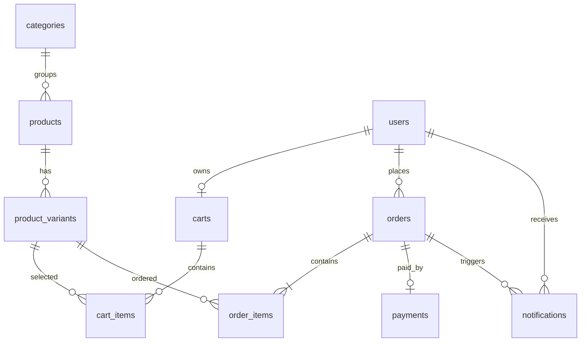

# E-Commerce Mini Backend

Backend Spring Boot 3.5 / Java 21 / MySQL 8. API prefix: `/api`. Versioned Flyway scripts are present under `src/main/resources/db/migration`, but the checked-in runtime configuration currently disables Flyway and uses Hibernate `ddl-auto=update`.

## Run locally — backend only

Open a PowerShell window for the backend. The `dev` profile is local-only and enables sample data; set the required secrets before starting:

```powershell
cd C:\DAAAN\shopee\shopee
$env:JAVA_HOME = 'C:\OpenJDK21\jdk-21'
$env:Path = "$env:JAVA_HOME\bin;$env:Path"
$env:JWT_SECRET = '<a unique random secret of at least 32 bytes>'
$env:ADMIN_PASSWORD = '<a unique password of at least 8 characters>'
.\mvnw.cmd spring-boot:run -Dspring-boot.run.profiles=dev
```

This starts only Spring Boot. Local database defaults come from `application-dev.properties` and match the Docker command above: database `shopbanquanao`, user `app_user`, password `app123`. Override them with `DB_URL`, `DB_USERNAME`, and `DB_PASSWORD` if needed. The API fails to start if `JWT_SECRET` is missing or shorter than 32 bytes. Outside `dev`/`test`, an early `EnvironmentPostProcessor` validates a non-root database account, password, a JWT secret of at least 32 bytes, and a `DB_URL` query parameter `sslMode=VERIFY_IDENTITY` backed by a trusted certificate. `ADMIN_EMAIL` and `ADMIN_PASSWORD` are optional one-time bootstrap credentials and must be provided together when used. Configure these before deployment; do not activate the `dev` profile against production data.

At startup, `AdminBootstrap` creates the initial admin when that email does not already exist. In `dev`, the email defaults to `admin@local`; `ADMIN_PASSWORD` must be supplied. An existing admin's active state is preserved on restart.

`DemoDataSeeder` prepares sample customer accounts, products, variants, carts, orders, payments, and notifications only in the `dev` profile. Its sample password defaults to `123456` only in that profile. Seeding is disabled outside `dev` and can be disabled locally with `BOOTSTRAP_DEMO_DATA=false`. Never activate the `dev` profile against a production database.

`ProductCatalogSeeder` loads 100 sample products from `src/main/resources/catalog/products-100.json` on backend startup, balanced across seven categories. It creates the categories as needed, enables them, and inserts missing products with one size/color variant. A product already present by case-insensitive name and category is preserved and skipped, so restarting the backend does not reset admin-managed data. The seeder does not delete products already in the database; a database that previously received all 350 sample products may continue to show them. Set `BOOTSTRAP_PRODUCT_CATALOG=false` to disable this seeder. The sample prices, stock, and Unsplash URLs are simulated/reference data, not verified Shopee listings.

Vercel hosts the React/Vite frontend; it does not start this Java seeder or write to MySQL. Deploy the backend separately with access to the same persistent database. On Render, set the database URL as `SPRING_DATASOURCE_URL` (or `DB_URL`), along with `DB_USERNAME`, `DB_PASSWORD`, and `JWT_SECRET`; use a JDBC MySQL URL with `sslMode=VERIFY_IDENTITY`. Set the Vercel build variable `VITE_API_BASE_URL` to the backend origin (without `/api`) and backend `APP_CORS_ALLOWED_ORIGINS` to the deployed frontend origin. The frontend requests its catalog from `GET /api/products`. Catalog seeding happens after the service starts, so reducing the seed from 350 to 100 can shorten first startup and test data setup, but it does not skip Maven dependency downloads during the Docker build. These deployment settings have not been exercised against live Render/Vercel/database accounts in this workspace.

Clean or build only the backend from this directory:

```powershell
.\mvnw.cmd clean
.\mvnw.cmd package -DskipTests
```

Frontend is a separate project in `C:\DAAAN\shopee\frontend`; use its own PowerShell window and README.
## Main endpoints

| Actor | Endpoint | Purpose |
| --- | --- | --- |
| Public | `POST /api/auth/register`, `POST /api/auth/login` | Register USER and obtain JWT |
| Public | `GET /api/products`, `GET /api/products/{id}` | Search and browse active products and variants |
| Public | `GET /api/products/categories`, `GET /api/products/filters` | Load current categories, sizes, colors and price range for the UI |
| Public | `GET /api/products/{id}/related` | Load other active products from the same category |
| USER | `GET /api/cart`, `POST /api/cart/items`, `PUT /api/cart/items/{id}`, `DELETE /api/cart/items/{id}` | Manage own cart |
| USER | `POST /api/orders`, `GET /api/orders`, `GET /api/orders/{id}` | Checkout and view own orders |
| USER | `GET /api/notifications`, `PUT /api/notifications/{id}/read` | Read own order notifications |
| USER | `GET /api/wishlist`, `POST /api/wishlist/{productId}`, `DELETE /api/wishlist/{productId}` | View, save, and remove favorite products |
| ADMIN | `GET/POST /api/admin/products`, `PUT/DELETE /api/admin/products/{id}` | Manage products; delete means deactivate |
| ADMIN | `GET/POST /api/admin/categories`, `PUT/DELETE /api/admin/categories/{id}` | Manage categories; deleting a category that still has products returns 409 |
| ADMIN | `POST/PUT/DELETE /api/admin/products/{productId}/variants[/{variantId}]` | Manage product variants |
| ADMIN | `GET /api/admin/orders`, `GET /api/admin/orders/{id}` | View orders |
| ADMIN | `PUT /api/admin/orders/{id}/confirm`, `PUT /api/admin/orders/{id}/cancel` | Transition PENDING order; cancel restores stock |

Send the login token as `Authorization: Bearer <accessToken>`. Responses use JSON; validation errors return 400, missing resources 404, conflicts or invalid order transitions 409, unauthenticated requests 401, and role failures 403.

Registration always creates a `USER`; role cannot be selected in the public registration request. `/api/admin/**` requires `ADMIN`, while cart, order, and notification APIs require `USER`. Public product browsing and authentication remain available without a token. The JWT filter reloads the account role from the database for each request, so changing an account role takes effect without trusting a client-supplied role claim.

The product list returns a page object with `items`, `page`, `size`, `totalElements`, `totalPages`, `first`, and `last`. Example home/catalog request:

```text
GET /api/products?keyword=ao&category=Áo%20thun&size=M&color=Black&minPrice=100000&maxPrice=500000&inStock=true&page=0&pageSize=12&sort=price_asc
```

All filters are optional. `keyword` searches product name and description; `size`, `color`, and `inStock` match a product variant; price bounds apply to the product catalog price. Supported sorts: `newest`, `price_asc`, `price_desc`, `name_asc`, `name_desc`. `page` accepts 0–10,000 and `pageSize` accepts 1–100. Filter options are queried from active catalog data, so the web UI can render the available choices without hard-coded product values.

Products must reference an existing active category. The admin product request accepts a `categoryId`; product responses return both `categoryId` and the category display name. For example:

```json
{
  "name": "Áo thun basic",
  "categoryId": 1,
  "description": "Cotton co giãn",
  "price": 199000,
  "imageUrl": "https://example.com/ao-thun.jpg",
  "status": "ACTIVE"
}
```

`GET /api/admin/categories` returns category IDs, descriptions, active state, and product counts. `GET /api/products/categories` remains a public list of category names available in the active storefront. Migration V5 creates the category table, copies existing product category values into it, and links each product to its category.

## Tables / relationships



Checkout locks cart and variant rows and writes the order, order lines, payment and stock changes in one transaction. Order line prices are snapshots. Confirm/cancel and notification creation share a transaction; cancellation returns each line's quantity to stock.

## Test coverage

The automated backend tests include a Spring context-load test, a critical business flow through MockMvc/H2, admin-bootstrap tests, and production configuration guard tests. The test profile uses a uniquely named in-memory H2 database and `ddl-auto=create-drop`. No production MySQL connection is available in this repository session. Production runtime currently disables Flyway and uses `ddl-auto=update`; SQL migrations are present but are not automatically run by the checked-in default configuration. Confirm the deployed schema and migration history before changing this strategy.
